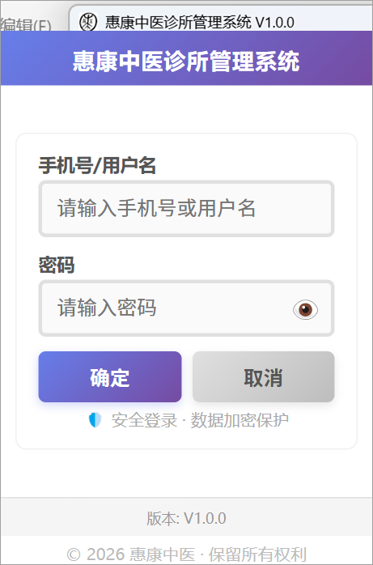
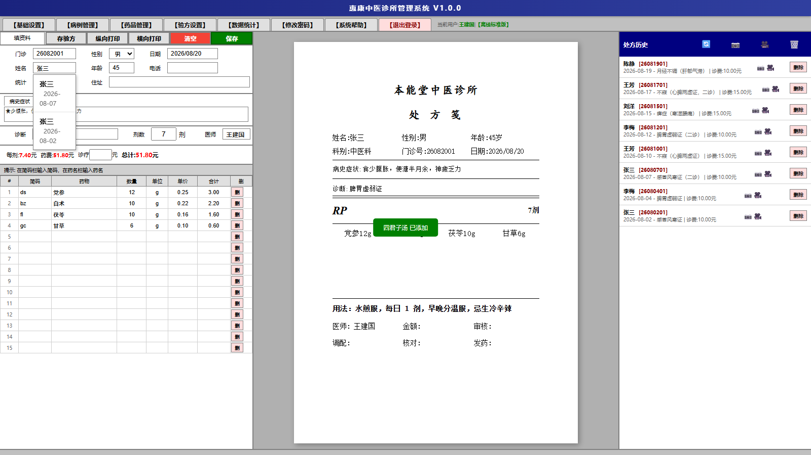
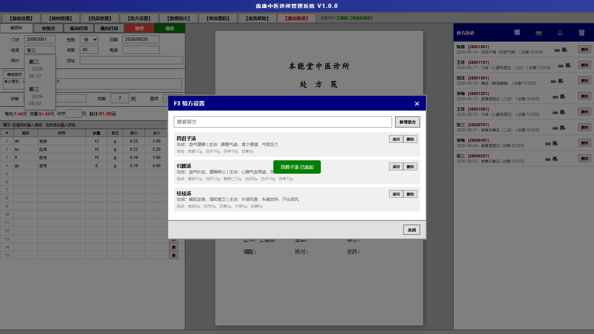
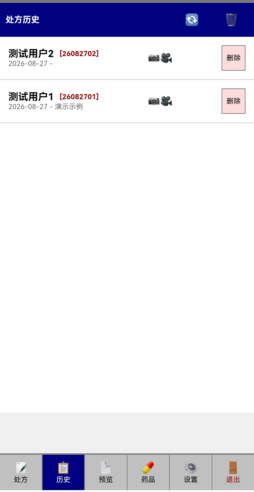
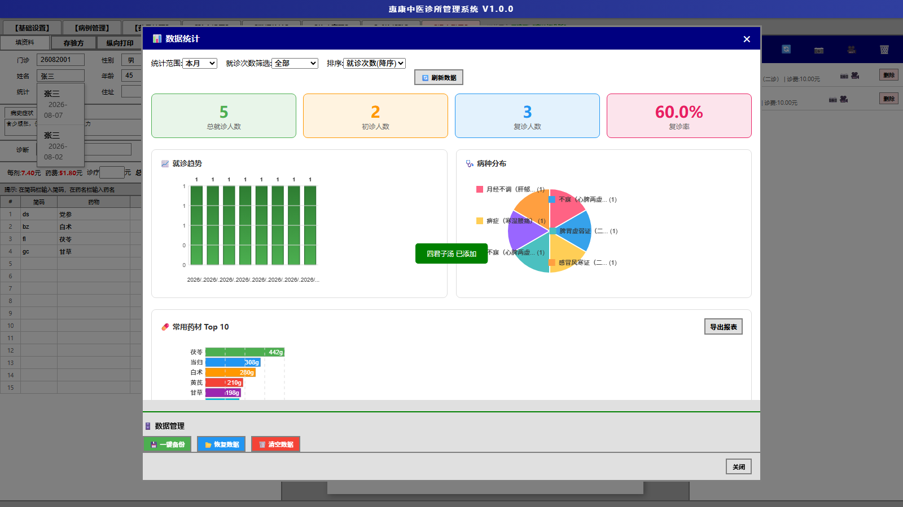
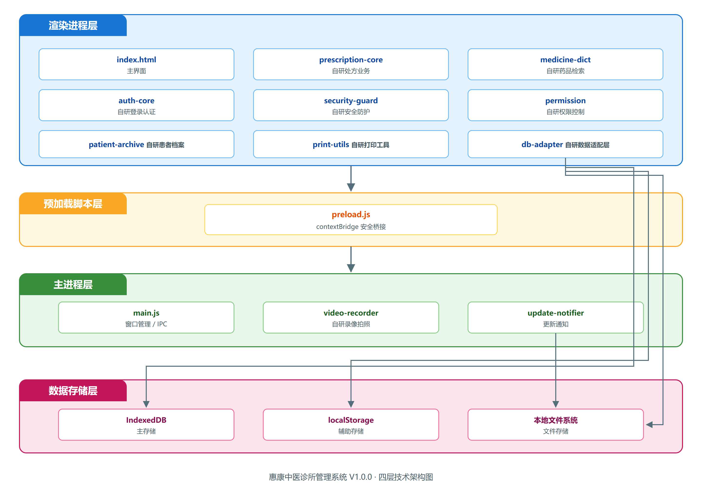

<div align="center">

# 惠康中医诊所管理系统 V1.0.0

**软件操作说明书**

</div>

<br>

<div align="center">

**软件名称：惠康中医诊所管理系统**

**软件版本：V1.0.0**

**著作权人：高碑店惠康堂中医诊所有限公司**

**编制日期：2026 年 11 月 05 日**

</div>

---

<div style="page-break-before: always;"></div>

# 目录

- 第一章 软件概述 ······ 1
- 第二章 软件安装 ······ 9
- 第三章 系统登录 ······ 12
- 第四章 基础设置 ······ 15
- 第五章 处方录入（核心功能） ······ 18
- 第六章 历史处方管理 ······ 26
- 第七章 药品管理 ······ 29
- 第八章 常用药品组合模板设置 ······ 32
- 第九章 患者就诊档案管理 ······ 35
- 第十章 数据统计 ······ 37
- 第十一章 用户管理（管理员） ······ 41
- 第十二章 录像与拍照 ······ 44
- 第十三章 系统帮助 ······ 47
- 第十四章 库存管理 ······ 50
- 附录 A：数据字段说明 ······ 53
- 附录 B：技术架构说明 ······ 56
- 附录 C：版本更新历史 ······ 58
- 附录 D：术语表 ······ 60
- 附录 E：软件著作权声明 ······ 62
- 附录 F：功能—代码对照表 ······ 64

---

## 第一章 软件概述

### 1.1 软件简介

惠康中医诊所管理系统 V1.0.0（以下简称"本软件"）是高碑店惠康堂中医诊所有限公司给自己诊所做的一套业务记录软件。

诊所每天要做的事就那么几件：开方、抓药、记台账、复诊时翻旧方。以前都记在纸上，字迹认不清、旧方子找起来慢，月底想看看开了多少方、哪几味药用得多，只能一张张数；药柜里哪些药快用完了，也常常是抓药时才发现。这套软件把这些事搬到电脑和手机上：医生在界面里开方，旁边同步显示处方笺，打印出来就是一张 A5 处方；处方存进本机，复诊时输入患者姓名就能翻出之前开过的方；药品和库存单独管理，低于设定数量会提醒；月底打开统计页面，多少人次、多少剂、药材用量一目了然。

用法上有两种：单机使用，数据只存本机，不联网也能开方、打印、统计；需要多台设备共用一个诊所的数据时，在配置里打开云端同步即可。权限分标准版和机构版：标准版给单个医师用；机构版可以管理多个用户、查看全所处方。Windows 电脑和 Android 手机都能装，两边的数据和操作方式是一致的。

需要说明的是，本软件只负责把医生写的内容记下来、存下来、打出来，不做任何医学判断：不具备疾病诊断、病史分析、诊疗建议或远程行医功能，也没有医疗诊断资质。系统里"诊断""病史"这些栏目，填的都是执业医师自己录入的文本，软件不对其作任何解读或建议。

功能范围上，软件提供处方文本存档、药材台账管理、患者基础信息登记和就诊过程影像留存，另外附带药品与库存管理、舌脉与症状快捷录入、验方调用、历史处方与患者档案、数据统计、用户与权限管理、数据备份恢复等辅助功能。两套数据模式（本地存储、云端同步）和两套权限配置（标准版、机构版）都是程序自带的功能模块，通过配置文件切换，不是商品分级。

### 1.2 开发背景

这套软件最早就是为解决自己诊所的问题做的。中医开方和西医不太一样：一人一方，药味加减多，复诊时往往要翻上次的方子作参考；药材有先煎、后下、烊化这些讲究，抓药的人得看清楚；诊所规模不大，常常一两个医师，忙起来更容易出错。

纸处方的问题很直接。字迹潦草时认不清，方子攒多了找起来费劲；月底想统计这个月开了多少方、哪几味药用得多，只能一张一张数；库存也常是抓药时才发现不够。也看过市面上的诊所软件，多数按西医流程设计，对中医的方剂、煎法、复诊参考支持不多；云端软件要一直联网，诊所网络不好，或者不愿意把病人资料放到外面，用起来不踏实。

所以我们按诊所自己的习惯做了这套系统：把开方、打印、存档、查历史方、管药查库存、月底统计这几件事做顺，数据默认存在本机，需要多台设备共用时再打开云端同步。软件不追求功能多，重点是把每天都要用的几件事做稳。

### 1.3 主要功能

本系统的功能围绕中医诊所"开方—存档—抓药—复盘"的实际流程组织，主要包括：

1. **处方录入与存档**：录入患者基础信息、病史症状文本、诊断文本、药品明细（名称、简码、用量、单位、单价、合计）、剂数、诊疗费，右侧实时生成 A5 处方笺预览；保存时自动生成处方编号。
2. **处方编号自动生成（防重号）**：编号格式为"YYMMDD + 当日序号"（如 26080301；单日超过 99 张时序号自然扩展为 3 位）。序号同时写入本地缓存、浏览器数据库与本地文件三处；当日最大号优先从内存中的处方全集扫描，取不到时再回退到存储读取；数据尚未加载完成时拒绝生成并给出提示——宁可让医生重开一次，也不生成重复处方号。
3. **药品检索与选择**：简码列输入拼音简码、药名列输入中文，均可实时弹出候选；候选按"置顶药 > 使用频次 > 药名长度 > 简码长度"的顺序排列；选中后自动带出单位、单价并跳转用量列。出厂预置 469 味常用中药材（含简码、进价、单价、单位、常用用量），另经版本化增量补丁追加 2 味（实装 471 味），并支持 CSV/Excel 批量导入扩展。
4. **金额联动计算**：行合计 = 单价 × 用量；药费 = 各行合计之和；总计 = 药费 × 剂数 + 诊疗费，均保留两位小数；剂数为空时默认按 7 剂计算。
5. **中药特殊煎法自动标注**：按《中国药典》及《中药学》教材归纳 8 类 67 味特殊煎法（先煎 21、后下 12、包煎 9、烊化 6、另煎 6、冲服 10、煎汤代水 2、兑服 1），开方时自动在药名后标注"（先煎）"等；药库中手动设置为非普通煎的，以药库设置为准；并内置误匹配排除表，避免"香附子"命中"附子"、"肉豆蔻"命中"豆蔻"。
6. **舌脉与症状快捷录入**：内置中医症状体征词典（组合模板/舌质/舌苔/脉象/望闻诊/问诊 6 类 120 词条，各带简码），按 Alt+S 打开快捷面板；勾选词条后按"同分类用「、」、跨分类用「，」、末尾不加标点"的规则拼接插入光标处，插入点前若无标点会自动补「，」；高频词条按使用次数前置，使用记录保存在本机。
7. **诊断快速录入**：Alt+D 打开诊断面板，支持按简码或中文检索病名/证型，按"简码前缀 100 分 / 简码包含 60 分 / 中文前缀 90 分 / 中文包含 50 分"打分排序，选中后按"病名（证1、证2）"格式组合填入；最近使用按使用次数与时间衰减排序。
8. **以证选方**：Alt+1 打开常用药品组合模板（验方），按方名/功效/主治选择后一键填入药品明细，可在其基础上增减药味、调整剂量。
9. **历史处方与回收站**：右侧历史列表按处方编号倒序显示，支持按患者姓名检索、查看、编辑、删除；删除进入回收站保留 30 天，可还原或彻底删除；彻底删除时同步冲回库存。
10. **库存管理（可开关，默认关闭）**：启用后保存处方按"每味用量 × 剂数"自动扣减库存；同日覆盖或修改历史处方时按差值冲正（只扣增量、退回减量），并以幂等标记避免重复扣减；支持入库登记、盘点调整、批量入库（CSV/Excel，逐行"药名,数量,备注"）、流水导出；库存低于阈值时红字预警，拾药下拉显示"不足本次所需"。
11. **数据统计**：按今日/本周/本月/本季度/本年筛选，输出就诊人次、初诊/复诊人数、复诊率、病种分布、药材用量 Top10、就诊趋势（近 14 天）、月度报表（收入/诊疗费/成本/利润/剂数），并支持 CSV 导出；报表先按当前用户权限过滤处方范围。
12. **患者就诊档案**：以患者为维度汇总历次处方，支持中文包含 + 姓氏拼音码前缀检索（300ms 防抖）；性别可依据姓名用字自动推断（女 100 字/男 100 字两性计分表），医生手动选择优先且不会被自动覆盖。
13. **处方笺打印**：ISO A5（148×210mm）纸型，纵向/横向两种排版；页边距上 22.5mm、左右各 13mm、下 15mm；诊所名与标题 22pt 楷体，正文 10.5pt，煎服法 9pt；药味三列网格排布；纸面高度预留 0.5mm 舍入余量，避免打印时甩出第二页。打印通道依次为 Android 原生打印、Electron 主进程打印、独立打印窗口。
14. **语音开方输入**：在支持语音识别的环境（且为授权版本）显示麦克风入口，口述药名/年龄/剂数后填充到对应字段并以浅紫色高亮待医生确认；药名必须经候选列表确认后才填入，未匹配不会静默填充。
15. **多用户与权限**：标准版为单用户；机构版支持用户管理、角色分配（管理员/普通用户/前台收费）、处方查阅范围控制；版本标识经归一化后由单一读取链判定，按钮显示由单一写入源统一装配。
16. **就诊过程影像留存**：调用摄像头录制就诊对话、拍摄患者舌部照片，文件自动关联到最近保存的处方患者，便于形成完整就诊资料档案；仅做图片与视频留存，不做任何医学分析或判读。
17. **数据备份与恢复**：一键将全量数据备份为本地文件，支持从备份文件恢复；备份文件附带 HMAC-SHA256 校验值，导入时比对校验值，若不一致会提示风险并由用户确认是否继续。
18. **安全与授权**：主进程账户口令使用 PBKDF2-SHA256（60 万轮、每密码 16 字节随机盐）；登录成功后旧格式哈希自动升级；敏感凭据经系统加密接口（Windows DPAPI）加密，密文与本机及当前登录用户绑定；许可证文件、用户表备份与试用计数使用由本机硬件指纹派生的用途密钥签名，换机即失效；运行期拦截 F12 与远程调试启动参数。

### 1.4 技术特点

本系统由 1 个主程序（index.html，约 1.16 万行）与 11 个独立业务模块、26 个主进程模块组成：主程序承载开方、打印、历史、统计等核心交互，业务模块沉淀可复用的领域逻辑，主进程模块负责窗口、打印、许可、录像、更新等系统能力。实现上的主要特点如下（具体文件与函数见附录 F）。

1. **中药煎法规则化匹配**：以规则表形式固化 8 类 67 味特殊煎法，匹配顺序为"精确匹配 → 误匹配排除表 → 关键词按长度降序包含 → 空"，生效优先级为"药库手设（非普通煎）> 规则表 > 普通煎"。规则表是独立数据表，新增药味只需增行，不必改代码。
2. **症状舌脉结构化录入**：词条按 6 分类组织、每条带简码；拼接按分类序数升序、组内「、」、组间「，」、末尾无标点；词条使用频次与诊断最近使用均持久化在本机，用得越多越顺手。
3. **处方编号防重号设计**：编号生成收口于单个函数；序号三级持久化（本地缓存、浏览器数据库、本地文件），启动时扫描权威处方集补齐缺失编号；数据未就绪时拒绝生成而非降级生成，从设计上排除重号处方。
4. **库存差值冲正**：处方记录携带幂等标记（记录本次已扣各药数量），重存时只扣增量、退回减量；删除处方且回收站确已清除后才冲回，防止"幻影退回"；流水分入库、处方消耗、处方调整、删除冲回、盘点调整、导入建账六类，本地保留最近 3000 条。
5. **统计口径写在代码里**：初诊/复诊按患者姓名聚合判定；复诊率 = 复诊人数 ÷ 总就诊人数；药材用量 = Σ（用量 × 剂数）；就诊趋势按 ISO 日期键分组（避免本地化日期字符串排序错乱）；月度报表的诊疗费口径可自识别，并按当前用户权限过滤处方范围。
6. **版本单一真值链**：多种版本标识（机构版/标准版/云端版/离线版/语音版）统一归一化为内部值，读取顺序为"权威插槽 > 配置文件 > 全局变量 > 模块缓存"；写入配置时同步刷新全局变量与按钮显示，避免"版本显示与实际权限不一致"。
7. **A5 处方笺毫米级排版**：按 ISO A5 纸张与固定页边距（上 22.5mm、左右 13mm、下 15mm）排版，药味三列网格，标题 22pt、正文 10.5pt、煎服法 9pt；纸面高度预留 0.5mm 舍入余量以适配不同打印驱动的取整差异。
8. **三级本地持久化**：设置与轻量状态存本地缓存；处方、回收站、媒体、备份存浏览器数据库（PrescriptionDB v3、PrescriptionMediaDB、PrescriptionBackupDB）；桌面端另经主进程写入用户数据目录文件。写入路径统一收口，便于一致性与迁移。
9. **密码存储分级与透明升级**：主进程账户采用 PBKDF2-SHA256（60 万轮、16 字节随机盐、自描述哈希串），校验时按哈希串中的参数重算；登录成功后自动将旧的 SHA-256 哈希重算为 PBKDF2；渲染层本地用户表沿用 SHA-256 + 固定盐以兼容历史数据，属于已知限制，不影响主进程账户安全性。
10. **安全防护分层**：运行期对关键业务入口做登录态校验；主进程拦截 F12 与 --inspect、--remote-debugging-port 等调试参数；页面侧做反调试与降级处理；许可证、用户表备份、试用计数使用硬件指纹派生的用途密钥签名，换机失效。
11. **离线优先**：全部业务数据默认保存在本机，断网可正常开方、打印、统计；云端同步模式为可选配置（配置文件切换），不影响离线使用。
12. **多端同源**：桌面端（Electron）与移动端（Capacitor/Android）共享同一套业务逻辑与数据结构，界面按屏幕尺寸自适应。

### 1.5 软件适用场景

本系统适用于以下使用环境：

1. **单医师设备**：单医师使用的电脑或移动设备，需要规范处方记录、保存业务数据、统计业务数据。本地存储模式满足数据隐私需求。
2. **多医师局域网设备**：多名医师使用的设备，需要按医师统计工作量、查阅全部处方记录。机构版权限配置提供用户管理与处方查阅功能。
3. **多端协同设备**：需要在不同设备间共享处方数据、药品库与常用药品组合模板的场景。云端同步模式支持多端数据共享与协作。
4. **就诊资料存档设备**：通过录像与拍照功能记录就诊过程与患者舌部照片，为就诊资料存档备查提供素材。

### 1.6 与同类软件的差异化优势

相比市面的医疗信息化软件，本系统具有以下差异化优势：

1. **双数据模式架构**：同时内置本地存储与云端同步两套数据模式，本地存储满足数据隐私与断网可用需求，云端同步满足多端协同需求，用户可按需选择。
2. **中医特色鲜明**：原生支持常用药品组合模板调用、历史处方快速调取、中药简码检索等中医特色功能，而非简单照搬西医流程。
3. **轻量易用**：程序支持两种本地部署运行方式（NSIS 安装版与便携版），无需安装数据库，无需配置服务器，开箱即用。
4. **跨端协同**：桌面端与移动端共享核心业务逻辑，数据结构一致，可灵活选择使用场景。
5. **数据可控**：本地存储模式下所有数据保存在用户本机，用户完全掌控数据资产；云端同步模式支持启用/关闭灵活切换，用户自主选择数据是否上传云端。
6. **安全加固**：多重安全防护机制（远程调试拦截、开发者工具拦截、密码加密、会话超时等），防止数据泄露与篡改。
7. **双权限配置**：标准版（单用户）与机构版（多用户协同）两套程序内置权限模块，满足不同规模诊所的管理需求。
8. **就诊资料档案**：内置录像与拍照功能，建立患者就诊过程录像与舌部照片档案，辅助就诊资料存档备查。

### 1.7 运行环境

#### 1.7.1 桌面版运行环境

| 项目 | 要求 |
| --- | --- |
| 操作系统 | Windows 7 SP1 及以上 64 位操作系统（推荐 Windows 10/11） |
| 处理器 | Intel Core i3 及以上或同等性能处理器 |
| 内存 | 4GB 及以上（推荐 8GB） |
| 硬盘空间 | 500MB 及以上可用空间（含数据存储） |
| 显示器 | 1366×768 及以上分辨率（推荐 1920×1080） |
| 摄像头 | 选配，使用录像与拍照功能时需要 |
| 打印机 | 选配，使用处方打印功能时需要 |
| 运行时框架 | 内置 Electron 运行时，无需额外安装 |

桌面版提供两种本地部署运行方式：NSIS 安装版（.exe）与便携版（portable）。NSIS 安装版支持自定义安装目录、创建桌面快捷方式与开始菜单快捷方式；便携版为单文件可执行程序，无需安装，解压即用，数据保存在 exe 同级目录。

#### 1.7.2 APP 版运行环境

| 项目 | 要求 |
| --- | --- |
| 操作系统 | Android 7.0（API 24）及以上 |
| 处理器 | ARM 32/64 位处理器 |
| 内存 | 2GB 及以上 |
| 存储空间 | 200MB 及以上可用空间 |
| 摄像头 | 选配，使用录像与拍照功能时需要 |
| 屏幕 | 5.0 英寸及以上，推荐 720×1280 及以上分辨率 |

APP 版本通过 Capacitor 框架打包为 Android 原生应用（.apk），安装后即可使用，所有数据保存在应用私有目录。

#### 1.7.3 云端同步模式运行环境

云端同步模式在桌面版与 APP 版运行环境基础上，额外需要以下条件：

| 项目 | 要求 |
| --- | --- |
| 网络环境 | 启用云端同步时需要互联网连接（推荐带宽 10Mbps 及以上） |
| 运行模式 | 程序内置本地云端同步接口开关，可随时启用或关闭 |

云端同步模式为程序内置功能，通过 sync-engine.js 同步引擎模块实现本地与远端数据存储的双向数据同步，软件本身不提供任何对外云服务运营，仅内置同步接口代码模块。用户可在登录后通过界面顶部的同步状态指示器查看当前同步状态，并随时切换为仅本地存储模式。

### 1.8 独创性说明

本软件为中医诊所日常业务而设计，以下六项设计来自真实诊所的约束条件，不是通用框架或模板能直接提供的，也是本次提交的源程序鉴别材料的选材主线。

**（一）中药特殊煎法规则表与误匹配排除表**
中医处方中"先煎、后下、包煎、烊化、另煎、冲服"等特殊煎法直接影响疗效，属于开方时必须交代的内容。系统把这些知识固化为规则表：8 类 67 味，按《中国药典》与《中药学》教材归纳；匹配时先精确命中、再过误匹配排除表（"香附子"含"附子"、"肉豆蔻"含"豆蔻"，若只做包含匹配会误标），最后按关键词长度降序做包含匹配（长词优先，保证"煅牡蛎"优先于"牡蛎"）；药库中医生手动设置的非普通煎法优先级最高。规则表可增行扩展，不必改代码；具体实现是 prescription-core.js 中的 JIANFA_RULES 表与 getAutoJianfa 函数。

**（二）舌脉与症状的结构化录入**
中医四诊内容（舌质、舌苔、脉象、问诊）在纸质处方上通常是一段自由文本，录入慢且不统一。系统内置 6 类 120 条词条（组合模板/舌质/舌苔/脉象/望闻诊/问诊），每条带简码；点选后按"分类序数升序、同分类用「、」、跨分类用「，」、末尾不加标点"拼接插入光标处，插入点前若无标点自动补「，」；词条按使用频次前置，使用记录与诊断最近使用保存在本机。该拼接规则解决了"多次插入后标点混乱"的实际问题，是纸质流程无法直接照搬的细节；相关实现集中在 symptom-dict.js。

**（三）处方编号防重号（fail-closed）**
诊所处方编号要求"当日连续、不重号"，但浏览器端存在数据尚未加载完成就允许开方的时间窗。系统将编号生成收口到单一函数：序号同时写本地缓存、浏览器数据库与本地文件三处，读取时优先扫内存权威处方集；**数据未就绪时拒绝生成并提示，而不是降级生成**——医疗场景"拒绝一次开方"远优于"生成重复处方号"；历史数据中格式不合法的编号，按就诊日期与创建时间批量补号并写回。编号逻辑集中在主程序的 getGlobalMaxSerial 与 generatePrescriptionNo 两处。

**（四）库存差值冲正与幂等标记**
中药库存必须随处方变动，但医生常在同一天修改或覆盖处方，简单"保存即扣减"会导致库存越用越少。系统在处方记录内保存一个幂等标记（本次每味药已扣数量），重存时计算"本次应扣 − 上次已扣"，只扣增量、退回减量；删除处方时只有在回收站确已清除后才冲回，避免"删除又还原"造成幻影退回。库存流水分六类记录，可导出核对；实现位于 stock-core.js 的 applyStockDelta 与 installStockHooks。

**（五）统计口径与报表的自识别**
诊所关心的指标必须口径固定才可比较：初诊/复诊按患者姓名聚合判定；复诊率 = 复诊人数 ÷ 总就诊人数；药材用量 = Σ（用量 × 剂数）；趋势按 ISO 日期键分组（避免本地化日期字符串把"9 日"排到"10 日"后）；月度报表的诊疗费存在"计入收入/单列"两种记账习惯，系统通过比对数据特征自动识别口径；报表先经权限过滤，普通用户看不到他人处方。上述口径由 analytics-core.js 统一实现。

**（六）A5 处方笺的毫米级排版**
诊所实际使用 ISO A5 处方纸（148×210mm，非 B5）。系统按 A5 固定页边距（上 22.5mm、左右各 13mm、下 15mm）、标题 22pt 楷体、正文 10.5pt、煎服法 9pt、药味三列网格排版；纸面高度预留 0.5mm 舍入余量，因为不同打印驱动对毫米取整方式不同，差 0.5mm 就会把签名区甩到第二页。这些参数来自反复实机打印调试，不是通用模板的默认值；排版参数写在主程序的 printPrescription 中。

---

## 第二章 软件安装

### 2.1 桌面版安装

#### 2.1.1 NSIS 安装包安装

1. 获取安装包文件"惠康中医诊所管理系统-Setup-1.0.0.exe"，拷贝至目标电脑任意目录。
2. 双击安装包启动安装向导，若系统弹出"用户账户控制"对话框，点击"是"继续。
3. 进入欢迎界面，点击"下一步"。
4. 进入"选择安装位置"界面，默认安装路径为"C:\Program Files\惠康中医诊所管理系统"，可点击"浏览"更改目录。
5. 点击"下一步"进入"选择附加任务"界面，勾选是否创建桌面快捷方式、开始菜单快捷方式（默认均勾选）。
6. 点击"安装"开始复制文件，完成后勾选"运行 惠康中医诊所管理系统"可立即启动。
7. 点击"完成"退出安装向导。

安装完成后，在开始菜单"惠康中医诊所管理系统"程序组下创建"惠康中医诊所管理系统"快捷方式，并在桌面创建同名快捷方式图标。NSIS 安装版支持每机器安装（perMachine），一次安装可供本机所有用户使用。

#### 2.1.2 便携版安装

便携版为单文件可执行程序"惠康中医诊所管理系统-1.0.0.exe"，适用于 U 盘携带或不愿在系统中写入注册表的场景：

1. 获取便携版可执行文件，拷贝至任意可写目录（如 D 盘根目录、U 盘根目录等）。
2. 双击 exe 文件即可启动软件，无需安装。
3. 软件运行时在 exe 同级目录自动创建 data 子目录保存数据文件。如该目录不可写，则自动回退到系统 userData 目录。

便携版与安装版功能完全一致，区别仅在于数据存储位置与是否在系统中注册。

#### 2.1.3 首次启动配置

首次启动软件时，系统自动执行以下初始化操作：

1. 读取 exe 同级目录或安装目录下的 config.json 配置文件，加载诊所名称、默认医师姓名、权限配置等基础配置。
2. 初始化 IndexedDB 数据库 PrescriptionDB，创建 prescriptions、settings 等对象仓库。
3. 加载默认用户列表（来自 config.json 的 users 字段），如配置文件未提供则使用内置默认用户。
4. 显示登录界面，等待用户登录。

### 2.2 APP 版安装

1. 将 apk 文件传输至 Android 手机，可通过数据线、U 盘等方式传输。
2. 在手机文件管理器中找到 apk 文件，点击安装。
3. 首次安装时，系统弹出"允许安装来自此来源的应用"提示，请在系统设置中开启对应权限后继续安装。
4. 安装完成后点击"打开"启动应用，或在桌面找到"惠康中医诊所管理系统"应用图标点击启动。
5. 首次启动应用时，系统请求摄像头权限（用于录像与拍照功能），请点击"允许"以启用完整功能。

APP 版本启动时主动清除所有登录态，确保每次打开应用都需要手动登录。APP 端数据保存在应用私有目录，卸载应用会同步清除所有数据，请卸载前做好数据备份。

### 2.3 卸载说明

**桌面版卸载**：NSIS 安装版在"开始菜单"中点击"卸载 惠康中医诊所管理系统"快捷方式，或在"设置 - 应用"中找到"惠康中医诊所管理系统"点击"卸载"。卸载后程序文件被清除，用户数据默认保留。便携版直接删除 exe 文件及同级 data 目录即可。

**APP 版卸载**：长按桌面"惠康中医诊所管理系统"应用图标拖动至"卸载"区域，或在"设置 - 应用"中点击"卸载"。卸载后所有本地数据将被清除，请卸载前通过"数据统计 - 一键备份"功能导出数据。

---

## 第三章 系统登录

### 3.1 登录界面说明

启动本系统后，首先显示登录界面。登录界面采用居中卡片式布局，整体色调以浅色为主，背景配有渐变装饰元素。界面布局自上而下依次为：

1. **系统标题区**：居中显示"惠康中医诊所管理系统"字样，标题下方为版本标签位，显示当前版本标识（图中 V1.0.311 为内部构建号，随每次发布递增；本软件对外发布版本号为 V1.0.0）。
2. **诊所信息区**：在登录卡片顶部显示当前诊所名称，该名称由 config.json 配置文件中的 clinicName 字段提供。
3. **用户名输入区**：标签"手机号/用户名:"右侧为用户名输入框，placeholder 提示"请输入手机号或用户名"。如本机保存过历史用户名，输入框右侧显示下拉箭头按钮，点击展开历史用户名列表供快速选择。
4. **密码输入区**：标签"密码:"右侧为密码输入框，输入内容以掩码点显示。密码框设置 autocomplete="new-password" 属性，防止浏览器自动填充历史密码；输入框右侧提供显示/隐藏密码的切换按钮。
5. **登录按钮区**：包含"确定"与"取消"两个按钮。"确定"触发登录验证，"取消"退出应用。
6. **错误提示区**：登录失败时显示红色错误提示文字。

登录界面支持键盘操作：在用户名输入框按 Enter 键焦点跳转至密码输入框；在密码输入框按 Enter 键触发登录验证。



> 图 1：登录界面。窗口顶部显示软件名称"惠康中医诊所管理系统"与版本标识，下方依次是诊所名称、手机号/用户名输入框、密码输入框和"确定""取消"两个按钮。输入账号密码后点"确定"即可进入主工作界面。截图中的 V1.0.311 是内部构建号，每次发布递增；对外发布版本号为 V1.0.0。

### 3.2 管理员登录

管理员账号拥有系统的全部权限，包括用户管理、处方查阅、修改密码、开机自启设置等。登录步骤：

1. 启动软件，进入登录界面。
2. 在"手机号/用户名"输入框中输入管理员用户名（默认管理员账号由 config.json 配置文件提供）。
3. 在"密码"输入框中输入管理员密码。密码区分大小写。
4. 点击"确定"按钮或按 Enter 键提交登录。

登录验证流程：

1. 系统从 config.json 与本地用户存储中读取用户列表。
2. 查找匹配的用户名，如未找到则提示"用户名或密码错误"。
3. 对输入密码进行哈希计算，与存储的密码哈希值比对。系统支持 PBKDF2 与历史 SHA-256 哈希格式，登录成功后自动将旧格式升级为 PBKDF2 格式存储（见 3.5）。
4. 验证通过后，记录登录态到 localStorage，并启动 8 小时会话计时。
5. 隐藏登录界面，显示主工作界面。
6. 顶部标签栏按当前版本与用户角色显示对应入口：管理员在机构版下可见【用户管理】【处方查阅】入口（按版本配置显示）；【修改密码】【系统帮助】【退出登录】等入口对所有登录用户显示。

### 3.3 普通用户登录

普通用户账号仅拥有基础业务权限，可进行处方录入、药品管理、常用药品组合模板设置、患者就诊档案管理、数据统计等日常操作，但无法访问用户管理、处方查阅等管理员专属功能。普通用户登录步骤与管理员相同。

普通用户登录成功后，若所属版本或角色不具备用户管理权限，顶部标签栏不显示【用户管理】【处方查阅】入口；【修改密码】按钮对所有登录用户可见。普通用户仅能查看与编辑自己开具的处方历史，无法查阅其他用户的处方。

### 3.4 用户名记忆说明

本系统提供历史用户名记忆功能，登录成功后将用户名保存在本机，下次登录时可通过下拉列表快速选择：

1. **记录方式**：登录成功后系统自动将当前用户名加入历史用户名列表，无需额外勾选。
2. **下拉选择**：下次启动软件进入登录界面时，用户名输入框右侧显示下拉箭头按钮，点击展开历史用户名列表供快速选择。
3. **存储位置**：历史用户名列表保存在本机 localStorage 中，按命名空间区分。
4. **安全说明**：本功能仅保存用户名，不保存密码。记住密码功能在所有版本强制关闭，每次登录仍需手动输入密码，确保账号安全（见 3.5）。

### 3.5 密码安全说明

- 主进程账户（config.json 中的用户记录）使用 **PBKDF2-SHA256，迭代 60 万轮、每个密码独立 16 字节随机盐**，哈希串采用自描述格式（迭代次数、盐、密文写在同一条串里），校验时按串内参数重算；旧版 SHA-256 哈希在用户登录成功后自动升级为 PBKDF2，用户无感知。
- 渲染层（页面内）历史用户表仍使用 SHA-256 加固定盐，用于兼容早期数据；该限制不影响主进程账户口令的强度。
- 记住密码功能在**所有版本强制关闭**，每次打开均需重新输入密码；登录会话有效期 8 小时，到期自动退出。
- 需要长期保存的敏感凭据经系统加密接口（Windows DPAPI）加密，密文与本机、当前登录用户绑定；若检测到加密不可用则回退明文并在界面提示。

---

## 第四章 基础设置

### 4.1 诊所信息设置

诊所信息用于处方打印时的诊所名称显示，是软件运行的基础配置项：

1. 登录系统后，点击顶部标签栏的"【基础设置】"按钮，或按 F1 快捷键，弹出"F1 基础设置"对话框。
2. 在"诊所名称"输入框中输入诊所名称，如"惠康中医诊所"。该名称将显示在处方预览纸顶部以及打印输出中。
3. 诊所名称支持中文、英文、数字及特殊字符，建议长度不超过 20 个字符以保证打印效果。
4. 点击"保存"按钮保存设置。

诊所名称保存后立即生效，处方预览区与所有新开具的处方打印件均使用新名称。已保存的历史处方中嵌入的诊所名称不变。

### 4.2 医师信息设置

医师信息用于处方录入时的默认医师姓名填充：

1. 打开"基础设置"对话框（F1）。
2. 在"医师姓名"输入框中输入默认医师姓名，如"张医生"。
3. 在实际开方时，医师姓名也可在处方录入界面的"医师"输入框中临时修改，不影响默认设置。
4. 点击"保存"按钮保存设置。

如诊所拥有多位医师，建议为每位医师创建独立用户账号，登录后系统自动以当前登录用户的姓名作为默认医师。

### 4.3 处方编号设置

本系统的处方编号采用"日期 + 当日序号"的自动生成规则，编号格式为 YYMMDD + 当日序号，例如 26080301 表示 2026 年 8 月 3 日的第 1 张处方；单日超过 99 张时序号自然扩展为 3 位。编号生成内联实现于主程序，入口是 getGlobalMaxSerial 与 generatePrescriptionNo 两个函数。

编号生成逻辑：

1. 保存处方时取当前日期，格式化为 YYYY-MM-DD 后取后 6 位，作为 YYMMDD 日期串。
2. 读取当日已保存的最大序号（global_max_serial），该序号同时保存在 localStorage、IndexedDB 的 settings 仓库与桌面端本地文件三处，读取时依次回源。
3. 当日最大号优先从内存中的权威处方集扫描得出，内存集缺失时才回退到存储读取。
4. 序号加 1，不足两位前置补 0；单日超过 99 张时序号自然扩展为 3 位。
5. 拼接完整编号（YYMMDD + 序号），如 26080301，并将新序号回写三处存储。

补充说明：

- 数据尚未加载完成时，系统拒绝生成编号并给出提示，避免生成重复处方号；稍候重试保存即可。
- 历史数据中格式不合法的编号，系统按就诊日期与创建时间批量补号并写回。
- 加载历史处方时编号输入框保持只读，不会被历史编号覆盖。

### 4.4 打印模板设置

本系统处方笺采用 ISO A5（148×210mm）纸型，提供纵向与横向两种排版，分别适配不同摆放方式的处方笺纸张：

1. **纵向打印**：ISO A5 纵向处方笺，适合大多数诊所使用。处方内容自上而下排列。点击左侧工具栏"纵向打印"按钮或按 F8 快捷键触发。
2. **横向打印**：横向处方笺，适合需要更宽书写空间或特殊摆放纸张的场景。内容布局与纵向一致，整体方向旋转 90 度。点击左侧工具栏"横向打印"按钮触发。

打印模板内容动态生成，根据当前处方录入界面的内容实时渲染，具体的纸型、页边距与字号参数见 5.8。

### 4.5 其他设置项

基础设置对话框中还包含以下设置项：

1. **诊疗费**：默认诊疗费金额（元），新建处方时自动填入该值。该值仅为默认值，开方时可在处方录入界面临时修改。
2. **默认剂数**：默认处方剂数，新建处方时自动填入。可根据诊所主流病种调整默认值。
3. **开机自动启动**（仅管理员可见）：勾选后系统在电脑开机时自动启动。通过写入 Windows 注册表实现，仅管理员角色可见该选项。
4. **打印机设置 / 测试打印**：用于选择打印设备并测试处方笺输出效果。

所有设置项保存在 IndexedDB 的 settings 仓库与 localStorage 中，保存后立即生效，无需重启软件。

---

## 第五章 处方录入（核心功能）

处方录入是本系统的核心功能模块，集成于主工作界面。主界面采用三栏布局：左侧为资料录入区，中间为处方预览区，右侧为历史处方列表区。

### 5.1 主界面布局

1. **顶部标签栏**：横向排列的功能入口按钮，依次为：【基础设置】、【病例管理】、【药品管理】、【验方设置】、【数据统计】、【修改密码】、【题库】、【系统帮助】、【退出登录】。其中【用户管理】【处方查阅】入口按版本与用户角色显示（机构版管理员），【题库】入口在题库模块加载完成后显示（按版本提供），其余入口对所有登录用户显示。
2. **左侧面板（资料录入区）**：包含患者信息区、病史症状区、诊断信息区、金额信息栏、药品录入表格。
3. **中间面板（处方预览区）**：模拟纸质处方笺的实时预览，白底黑字。
4. **右侧面板（历史处方列表区）**：显示历史处方条目，支持滚动浏览。
5. **底部移动端导航栏**（仅移动端）：包含门诊、历史、预览、药品、设置、退出六个图标按钮。
6. **移动端快捷操作栏**（仅移动端）：包含录像、拍照、保存、清空、改密五个按钮。

桌面端与移动端共享同一套业务逻辑，布局根据屏幕尺寸自适应。



> 图 2：开方主界面。左侧填写患者信息、病史症状、诊断、剂数与药品明细，中间实时显示 A5 处方笺，右侧是历史处方列表。图中"阿胶 9g（烊化）""砂仁 10g（后下）"两处，是系统按煎法规则表自动加注的特殊煎法；金额栏的"每剂 / 药费 / 总计"随录入实时重算，总计 = 药费 × 剂数 + 诊疗费。

### 5.2 患者信息录入

患者信息录入区位于左侧面板顶部，包含以下字段：

1. **门诊号**：处方编号，只读字段，保存处方时自动生成。
2. **性别**：下拉选择框，可选"男"或"女"。系统可依据患者姓名用字自动推断性别（见 9.3），医生可手动选择；医生手动选择优先，不会被自动推断覆盖。
3. **日期**：就诊日期，只读字段，默认为当天日期。
4. **姓名**：患者姓名输入框，必填字段。输入时支持按姓名检索历史患者，点击候选可自动填充性别、年龄、电话、住址等历史信息。
5. **年龄**：患者年龄输入框，接受数字或文字。
6. **电话**：患者联系电话输入框。
7. **统计号**：患者统计编号，只读字段，由系统自动维护。
8. **住址**：患者住址输入框。

### 5.3 诊断信息录入

1. **病史症状**：多行文本输入框，输入患者主诉、现病史、既往史等文本内容。该字段为执业中医师自行录入的文本记录，本系统不对文本内容作任何医学判断或建议。可使用 5.3.1 的快捷面板辅助录入。
2. **诊断**：单行文本输入框，输入诊断文本。输入时处方预览区实时同步。可使用 5.3.2 的快捷面板辅助录入。
3. **剂数**：数字输入框，默认值为 7。剂数变化时处方预览与金额计算实时更新。
4. **医师**：单行文本输入框，默认填入基础设置中的默认医师姓名或当前登录用户姓名。

#### 5.3.1 舌脉与症状快捷录入（Alt+S）

系统内置中医症状体征词典，按 6 类 120 条词条组织（组合模板/舌质/舌苔/脉象/望闻诊/问诊），每条词条带简码。操作步骤：

1. 将光标定位到"病史症状"输入框中需要插入的位置。
2. 按 Alt+S 打开舌脉体征快捷录入面板。面板按分类展示词条，可切换分类标签；打开面板前系统已缓存光标位置。
3. 在面板中点选所需词条（如"舌淡红""苔薄白""脉弦"），可连续点选多条。
4. 点选后按以下规则拼接并插入光标处：同一分类的词条之间用「、」连接，不同分类之间用「，」连接，末尾不加标点；插入点之前若已有内容且前一个字符不是标点，系统自动补一个「，」。
5. 多次插入时，系统按缓存的插入位置继续追加，不会覆盖已插入内容；关闭面板后焦点回到病史症状输入框。

词条按使用次数排在前面（同一分类内稳定排序），使用记录保存在本机。


> 图 3：舌脉体征快捷录入面板（点主界面绿色【舌脉】按钮或按 Alt+S 打开）。面板顶部是名称/拼音简码搜索框（如 sd=舌淡、mx=脉弦），中部是组合模板、舌质、舌苔、脉象、望闻诊、问诊六类词条，底部"已选"区显示将要插入的内容。选中词条后点"确认插入"，系统按"同分类用「、」、跨分类用「，」、末尾不加标点"的规则拼好并插入病史症状框。

#### 5.3.2 诊断快速录入（Alt+D）

1. 按 Alt+D 打开诊断快速录入面板。
2. 在检索框中输入简码或中文，系统按以下权重打分排序：简码前缀命中 100 分、简码包含命中 60 分、中文前缀命中 90 分、中文包含命中 50 分。
3. 点击病名或证型条目选中；可同时选择病名与证型。
4. 选中后按"病名（证1、证2）"格式组合填入诊断框：仅有病名或仅有证型时以「，」连接多项；病名与证型同时存在时，证型以「、」连接后放入括号，多个病名各带同一组括号、病名之间用「，」。
5. 最近使用过的诊断按使用次数与时间衰减排序，排在前列便于复用。

### 5.4 药品选择与录入

药品录入区以表格形式呈现，列标题依次为：#（序号）、简码、药物、数量、单位、单价、合计、删。录入方式有三种：

#### 5.4.1 通过简码检索录入

1. 在"简码"列输入药品简码（简码为药品库数据自带的字段，如"黄芪"的简码为"hq"）。
2. 输入时系统在药品库中做简码前缀匹配，在下方显示候选药品下拉列表。
3. 候选按"置顶药 > 使用频次降序 > 药名长度升序 > 简码长度升序"排序，最多显示 20 条，已在本方中的药品不重复列出。
4. 使用上下方向键在候选列表中切换，按 Enter 键或点击候选项选中。
5. 选中后，系统自动填充该行的药物名称、单位、单价字段，并累计该药品的使用频次，焦点跳转至"数量"列。

#### 5.4.2 通过药名检索录入

1. 在"药物"列直接输入药品名称。
2. 输入时系统按药名包含匹配检索药品库，显示匹配候选下拉列表。
3. 选中候选药品后，自动填充简码、单位、单价字段。

#### 5.4.3 手动录入

对于药品库中不存在的新药，可直接在"药物"列手动输入药名，并手动填写单位、单价字段。

### 5.5 剂量与金额计算

每味药品的剂量（数量）与单位是处方的重要组成部分：

1. **数量**：药品剂量，数字输入框。输入数字后系统自动计算该行合计金额（数量 × 单价），并更新处方总金额。
2. **单位**：药品计量单位，默认为"g"（克）。
3. **用法**：处方用法说明显示在处方预览区底部，默认为"水煎服，日一剂，早晚分服"。

金额计算规则：

- 行合计 = 单价 × 用量，保留两位小数；药费 = 各行合计之和；**总计 = 药费 × 剂数 + 诊疗费**，保留两位小数。
- 剂数为空或为 0 时，界面按 7 剂展示并在失焦后回填 7；修改剂数或任一行用量后，处方预览与金额栏实时联动重算。
- 药品进价缺省时按"单价 × 0.8"估算，供成本统计使用，不参与患者收费；缺省逻辑在金额计算时一并处理。

### 5.6 处方预览

处方预览区位于主界面中间面板，以模拟纸质处方笺的形式实时显示当前录入内容。预览纸布局自上而下：

1. **诊所名称**：顶部居中显示，字体加粗放大。
2. **处方标题**："处 方 笺"字样，居中显示。
3. **患者信息行**：横向排列，包括姓名、性别、年龄、科别、门诊号、日期。
4. **病史症状区**：显示病史症状文本。
5. **诊断区**：显示诊断文本。
6. **药品列表区**：以"RP"标记开头，显示所有药品名称与剂量；设置为非普通煎的药品在药名后以"（先煎）""（后下）"等形式标注。
7. **用法与签名区**：底部显示用法说明与"医师:___（签字）"签名栏。

预览区随录入实时更新，所见即所得。预览区底部显示金额信息：每剂金额、药费、诊疗费、总计金额，所有金额保留两位小数。

### 5.7 处方保存

处方录入完成后，需保存到数据库以便后续查询与统计。保存步骤：

1. 确认患者姓名已填写（姓名为必填字段，未填写时保存会被拒绝并提示"请输入患者姓名！"）。
2. 确认至少录入一味有效药品（药品名不为空）。
3. 确认剂数大于 0。
4. 点击左侧工具栏"保存"按钮，或按 F9 快捷键触发保存操作。

保存流程内部执行步骤：

1. 校验登录状态，未登录则拒绝保存。
2. 获取当前时间戳，解析为 YYMMDD 日期串。
3. 生成新的处方编号（YYMMDD + 当日序号，规则见 4.3）。
4. 采集患者信息、药品表格数据。
5. 使用当前药品库的最新单价重新计算各药品合计与处方总金额。
6. 组装处方记录对象，字段包括：id、prescriptionNo、date、patientName、patientGender、patientAge、patientPhone、patientAddress、doctorName、medicalHistory、diagnosis、items、doseCount、totalAmount、registrationFee、createdAt、createdBy、createdByName。
7. 写入 IndexedDB prescriptions 仓库。
8. 如已启用库存管理，按"每味用量 × 剂数"扣减库存并记录流水（见第十四章）。
9. 更新内存中的处方历史数组（插入到数组开头），刷新右侧历史列表。
10. 记录审计日志，触发增量备份。
11. 弹出保存成功提示。

### 5.8 处方打印

1. 保存处方后，点击"纵向打印"或"横向打印"，或按 F8（默认纵向）。
2. 系统按 ISO A5 纸型（148×210mm）生成打印页面：纵向为 148mm 宽 × 210mm 高，横向为 210mm 宽 × 148mm 高；页边距上 22.5mm、左右各 13mm、下 15mm。
3. 打印通道优先调用 Android 原生打印接口；桌面端经主进程打印；均不可用时打开独立打印窗口，由用户在系统打印面板选择打印机并确认纸张为 A5。
4. 免费版在打印输出中叠加灰色"免费版"斜铺水印（仅打印件，屏幕处方笺不变）；授权版无水印。

### 5.9 以证选方

以证选方是本系统的中医特色功能，通过"以证选方"的方式快速调用常用药品组合模板（验方）生成处方记录：

1. 按 Alt+1 快捷键，弹出"Alt+1 中医辨证选方"对话框（即以证选方）。
2. 对话框列出所有已保存的验方，每条显示方名（加粗）、功效、主治信息。
3. 根据患者证型，点击对应的验方条目。
4. 系统自动将所选验方的组成药物填充到处方药品表格中，每味药的名称、剂量、单位、单价、合计自动计算填入。
5. 关闭对话框后，处方预览区与金额计算自动更新。
6. 用户可在自动填充的基础上根据患者具体情况调整剂量、增减药味。

> 说明：以证选方对话框列出的验方，与【验方设置】（F3）中维护的是同一批数据，界面示例见图 4。

### 5.10 历史处方快速调取

历史处方快速调取功能用于快速调用患者最近一次就诊的处方，适用于慢性病复诊或效不更方场景：

1. 按 Alt+9 快捷键触发历史处方快速调取。
2. 系统自动加载当前患者（处方录入界面"姓名"字段所示患者）最近一次的就诊处方。
3. 加载的处方药品明细填充到处方药品表格，诊断、剂数等字段同步填充。
4. 用户可在加载基础上调整剂量、增减药味，生成新的复诊处方。
5. 调整完成后，按 F9 保存为新处方。

### 5.11 语音开方输入

在支持语音识别且为授权版本的环境中，处方录入界面显示麦克风入口：

1. 点击麦克风入口开始语音输入，口述药名、年龄或剂数。
2. 识别结果填入对应字段，并以浅紫色高亮显示，等待医生核对确认。
3. 药名必须经候选列表确认后才会填入药品表格；未匹配到药品时不会静默填充，而是给出"未识别到药品，请说药名"之类提示。
4. 医生可随时手动修改语音填入的内容。

---

## 第六章 历史处方管理

### 6.1 历史处方列表

历史处方列表位于主界面右侧面板，显示当前登录用户开具的历史处方：

1. **列表头部**：标题"处方历史"，右侧显示刷新按钮与回收站按钮。
2. **列表内容**：默认显示最近 15 条处方，每条处方显示患者姓名、处方编号、日期、诊断、药品味数、总金额等关键信息。
3. **加载更多**：列表底部显示"加载更多"按钮，点击可加载更早的历史处方。

列表显示规则：普通用户仅能看到自己开具的处方（基于 createdBy 字段过滤）；管理员可看到全部用户的处方（通过"处方查阅"功能）；列表按时间倒序排列，最新处方在最上方。

### 6.2 处方搜索

本系统提供多种处方检索方式：

1. **按患者姓名实时检索**：在处方录入界面"姓名"输入框中输入字符，右侧历史处方列表实时过滤显示该患者的处方。
2. **历史处方列表内的搜索**：列表支持按姓名、门诊号、诊断等关键字搜索。
3. **患者就诊档案管理模块搜索**：在"病例管理"对话框中按患者姓名与日期范围搜索。
4. **处方查阅模块搜索**（管理员）：在"处方查阅"对话框中按姓名、门诊号、诊断关键字及医师筛选。

历史处方列表的实时检索采用防抖（debounce）技术，输入停止后延迟触发检索，避免频繁刷新影响性能。

### 6.3 处方查看与编辑

1. **查看处方**：在历史处方列表中点击某条处方，系统加载该处方的完整内容到处方录入界面。"门诊号"字段保持只读，显示原处方编号。
2. **编辑处方**：加载历史处方后，可修改任意字段。修改后点击"保存"按钮，系统重新计算金额并保存为新处方（生成新的处方编号与时间戳），原处方保留不变。这种"编辑即另存"的设计保证了处方历史的可追溯性。
3. **删除处方**：在历史处方列表中点击某条处方右侧的删除按钮，可将处方移入回收站。删除操作不会立即永久清除数据，可在回收站中恢复。

加载历史处方时，系统使用当前药品库的最新单价重新计算各药品合计与处方总金额，确保金额计算始终基于最新价格。

### 6.4 处方查阅（管理员）

处方查阅是管理员专属功能，可查阅全诊所所有用户开具的处方：

1. 机构版管理员登录后，顶部标签栏显示"【处方查阅】"入口（按版本配置显示）。
2. 点击该按钮，弹出"📋 处方查阅"对话框。
3. 对话框顶部显示搜索输入框（placeholder"搜索姓名/门诊号/诊断"）、医师筛选下拉框、"刷新"按钮。
4. 在搜索框中输入关键字，列表实时过滤显示匹配处方。
5. 点击医师下拉框选择特定医师，列表仅显示该医师开具的处方。
6. 点击某条处方可查看详情。

### 6.5 回收站管理

为防止误删除导致数据丢失，本系统提供处方回收站功能：

1. **进入回收站**：点击历史处方列表头部的"🗑️"按钮，弹出"处方回收站"对话框。
2. **恢复处方**：点击"恢复"按钮，将选中的处方从回收站恢复到处方历史列表。
3. **彻底删除**：点击"彻底删除"按钮，永久删除该处方，无法恢复；如已启用库存管理，彻底删除时同步冲回该处方已扣的库存（见 14.2）。
4. **清空回收站**：回收站底部提供"清空回收站"按钮，一键清空所有回收站内容。
5. **保留规则**：回收站最多保留最近 30 天的删除记录，最多 50 条，超出自动清理最早的记录。
6. **权限说明**：回收站按用户隔离，每个用户仅能看到自己删除的处方。

---

## 第七章 药品管理

### 7.1 药品列表

药品管理模块用于维护本诊所的中药药品库，是处方录入与金额计算的基础数据源：

1. 点击顶部标签栏"【药品管理】"按钮，或按 F2 快捷键，弹出"F2 药品管理"对话框。
2. 对话框顶部显示搜索框与"新增药品"、"导出药品"、"导入药品"、"清空药物库"等操作按钮。
3. 下方为药品列表区，以列表形式显示所有药品，每条显示药品简码、名称、单位、单价、进价、常用用量等信息。

出厂预置 **469 味**常用中药材（含简码、进价、单价、单位、常用用量），另经版本化增量补丁追加 2 味（川牛膝、怀牛膝），实装 471 味；补丁按版本号幂等应用，已应用过的机器不会重复追加。

药品列表加载时从本地存储读取药品数据，加载完成后建立药品名称到药品对象的映射表，供处方录入时的快速检索使用。

### 7.2 药品添加

1. 在药品管理对话框点击"新增药品"按钮，弹出药品编辑表单。
2. 填写药品信息：
   - **简码**：药品简码，如"黄芪"输入"hq"。必填。
   - **名称**：药品标准名称，如"黄芪"。必填。
   - **单位**：默认计量单位，如"g"（克）。
   - **单价**：药品单价（元/单位），数字格式。
   - **进价**：药品进价（元/单位），用于成本统计；缺省时按"单价 × 0.8"估算。
   - **常用用量**：该药的常用剂量，用于开方时的默认用量与库存预警判定。
   - **分类**（可选）：药品分类，如"解表药"、"补益药"等。
   - **库存预警阈值**（启用库存管理后显示）：0 表示不预警，库存小于等于该数值时红字提醒（见 14.3）。
3. 点击"保存"按钮，新药品添加到药品库，列表实时刷新。

### 7.3 药品编辑与删除

**编辑药品**：在药品列表中找到目标药品，点击"编辑"按钮，弹出药品编辑表单。修改字段后点击"保存"。药品单价修改后，后续新开具的处方将使用新单价计算金额。启用库存管理后，在此表单中直接修改库存数会自动记一笔"盘点调整"流水。

**删除药品**：在药品列表中找到目标药品，点击"删除"按钮。系统弹出确认对话框，确认后删除药品。已保存处方中包含该药品的记录不受影响。

### 7.4 药品导入导出

为方便药品库的批量维护与迁移，本系统提供药品导入与导出功能：

**导出药品**：点击"导出药品"按钮，系统将当前药品库导出为文件。支持 Excel（.xlsx，需 xlsx 库支持）、CSV（.csv）、JSON（.json）格式。

**导入药品**：点击"导入药品"按钮，选择药品文件（支持 .csv、.json、.xlsx、.xls 格式）。系统解析文件内容，弹出"选择导入方式"对话框，提供三种导入模式：

- **追加（保留现有药品）**：将导入的药品添加到现有药品库末尾。
- **覆盖（替换现有药品）**：用导入的药品完全替换现有药品库。
- **合并（同名覆盖，以导入为准）**：对同名药品以导入文件中的信息覆盖现有信息。

批量导入支持 CSV/Excel：文件编码自动识别（BOM → UTF-8 → 严格 UTF-8 校验 → GBK），避免 GBK 文件被静默解成乱码；列顺序为"药名,简码,单位,单价,进价,常用用量"等，导入前给出字段校验与错误行号提示。

导入前请务必备份现有药品库。Excel 导入功能依赖 vendor/xlsx.full.min.js 库，若该库未放置，Excel 导入不可用，请将 Excel 文件另存为 CSV 格式后再导入。

### 7.5 药品导入文件格式示例

#### CSV 格式示例

```
药名,简码,单位,单价,进价,常用用量
黄芪,hq,g,0.50,0.40,30
当归,dd,g,0.80,0.64,15
陈皮,cs,g,0.20,0.16,10
```

第一行为表头，必须包含药名、简码、单位、单价四个字段（进价、常用用量可选）。后续每行一味药，字段间用英文逗号分隔。文件编码建议使用 UTF-8。

#### JSON 格式示例

JSON 格式为对象数组，每个对象的字段名与 CSV 表头对应（药名、简码、单位、单价、进价、常用用量），字段值类型与 CSV 一致。

以上数据仅作格式示例，实际数值以本诊所药品库为准。

---

## 第八章 常用药品组合模板设置

### 8.1 模板列表

常用药品组合模板（程序中亦称"验方"）是医师在长期临床实践中总结的有效药品组合，本系统支持将常用药品组合保存为模板，便于快速调用：

1. 点击顶部标签栏"【验方设置】"按钮，或按 F3 快捷键，弹出"F3 验方设置"对话框。
2. 对话框顶部显示搜索框（placeholder"搜索验方"）与"新增验方"按钮。
3. 下方为模板列表区，每条模板显示方名、功效、主治、组成（药味与剂量）等信息，右侧为"调用""编辑""删除"按钮。



> 图 4：验方设置（F3）。对话框顶部是"搜索验方"与"新增验方"，列表中每条验方显示方名、功效、主治和组成（药味与剂量），右侧是"调用""编辑""删除"。点"调用"会把该方全部药味、剂量、单价、合计填入处方表格，预览与金额随之更新；以证选方（Alt+1）调用的也是同一批验方。

### 8.2 模板创建

1. 在模板设置对话框点击"新增验方"按钮，弹出模板编辑表单。
2. 填写模板信息：
   - **方名**：模板名称，如"桂枝汤"。必填。
   - **功效**：模板功效描述。
   - **主治**：主治病证描述。
   - **组成药物**：药品列表，每味药包括名称、剂量、单位。可从药品库选择或手动输入。
3. 点击"保存"按钮，新模板添加到模板库。

除通过模板设置对话框创建外，还可在处方录入过程中将当前处方保存为模板：完成处方录入后点击左侧工具栏"存验方"按钮，或按 F5 快捷键。

### 8.3 模板编辑与调用

**编辑模板**：在模板列表中找到目标模板，点击"编辑"按钮，修改字段后点击"保存"。模板编辑不影响已使用该模板开具的历史处方。

**调用模板**有两种方式：

1. **以证选方调用**：按 Alt+1 快捷键，弹出"中医辨证选方"对话框。根据患者证型点击对应模板，系统自动将模板组成药物填充到处方药品表格，单价从药品库查询最新值，合计金额自动计算。
2. **直接调用**：打开模板设置对话框（F3），在模板列表中找到目标模板，点击"调用"按钮。

---

## 第九章 患者就诊档案管理

### 9.1 患者就诊档案列表

患者就诊档案管理模块以患者为维度，汇总该患者在本诊所的所有就诊处方，便于回顾完整就诊记录：

1. 点击顶部标签栏"【病例管理】"按钮，弹出"病例管理"对话框。
2. 对话框顶部显示搜索区，包括患者姓名输入框、起始日期、结束日期、"搜索"与"重置"按钮。
3. 下方为档案列表区，默认显示全部档案。

档案列表显示规则：每条档案对应一个患者的就诊记录汇总；列表按最近就诊时间倒序排列；每条档案显示患者姓名、就诊次数、初诊日期、最近就诊日期等信息；点击某条档案可展开查看该患者的所有就诊处方详情。



> 图 5：患者就诊档案与历史处方。右侧"处方历史"按时间倒序显示该患者 5 次就诊记录，处方编号 26110102、26102001、26100901、26092601、26091401 连续可追溯，并附就诊日期与诊断；中间是处方笺预览，显示姓名、性别、科别、门诊号与就诊日期。图中患者姓名（楚某某）与医师姓名已作脱敏处理，仅用于演示。

### 9.2 档案查看与搜索

**查看档案**：在档案列表中点击目标患者条目，系统展开该患者的所有就诊记录，按时间倒序排列。每条就诊记录显示处方编号、日期、诊断、药品明细、剂数、金额等信息。

**档案搜索**支持按患者姓名与日期范围组合检索：

1. **按姓名搜索**：在"患者姓名"输入框中输入姓名（支持模糊匹配），点击"搜索"按钮。
2. **按日期范围搜索**：在"起始日期"与"结束日期"中选择日期，点击"搜索"按钮。
3. **组合搜索**：同时填写姓名与日期范围。
4. **重置搜索**：点击"重置"按钮清空所有搜索条件。

患者就诊档案管理模块的数据来源与历史处方模块一致，均来自 IndexedDB 的 prescriptions 仓库。普通用户仅能查看自己开具的处方对应的档案，管理员可查看全部档案。

### 9.3 患者检索与性别推断

- 患者检索：中文按"包含"匹配，另可按姓氏拼音码前缀/包含匹配，输入 300ms 防抖后触发；姓氏码表覆盖常见单姓与复姓，未收录字按小写字母原样参与匹配。
- 性别推断：内置女 100 字、男 100 字的两性用字计分表（共 200 字），按得分给出建议（女分 ≥ 男分且女分 > 0 → 女；否则男分 > 0 → 男）；**医生手动选择优先，自动推断不会覆盖手动选择**；姓名清空时重置为未选择。

---

## 第十章 数据统计

### 10.1 处方统计

数据统计模块提供多维度处方数据统计分析：

1. 点击顶部标签栏"【数据统计】"按钮，弹出"📊 数据统计"对话框。
2. 对话框顶部显示统计范围、就诊次数筛选、排序方式三个筛选条件，以及"刷新数据"按钮。

统计范围选项：今日、本周（近 7×24 小时）、本月（默认，1 日起）、本季度（季度首日）、本年（1 月 1 日起）。

**核心指标卡**：对话框顶部显示四个核心指标卡：总就诊人数、初诊人数、复诊人数、复诊率。

**就诊次数筛选**：通过下拉框可按患者就诊次数过滤（全部、1 诊、2 诊、3 诊、4 诊及以上）。

**排序方式**：就诊次数（降序/升序）、最近就诊（降序/升序）。

各项指标的统计口径如下：

| 指标 | 口径 |
|---|---|
| 统计范围 | 今日 / 本周（近 7×24 小时）/ 本月（1 日起）/ 本季度（季度首日）/ 本年（1 月 1 日起） |
| 就诊日期 | 优先取处方记录的 `date` 字段，缺失时取 `createdAt`（补录日期可生效） |
| 初诊/复诊 | 按患者姓名聚合，同一患者就诊次数 = 1 为初诊，> 1 为复诊 |
| 复诊率 | 复诊人数 ÷ 总就诊人数 × 100%，保留 1 位小数 |
| 病种分布 | 按诊断文本计数降序，空诊断计为"未诊断"，图表显示前 6 项、导出前 10 项 |
| 药材用量 Top10 | Σ（用量 × 剂数），降序取 10；数值 ≥10000 时图表以 kg 显示 |
| 就诊趋势 | 按 ISO 日期键（YYYY-MM-DD）分组，X 轴取最近 14 天、仅显示"日" |
| 月度报表 | 收入、诊疗费、成本（进价 × 用量 × 剂数）、利润、剂数；报表前经权限过滤 |

以上口径由统计模块统一实现，逐条对照见附录 F 第 10 项。



> 图 6-1：数据统计概览。顶部可选择统计范围、就诊次数筛选与排序；中部四个指标卡分别是总就诊人数、初诊人数、复诊人数和复诊率；下方是就诊趋势图与病种分布饼图；页面底部的"数据管理"区提供一键备份、备份与恢复、恢复数据、清空数据。所有指标都按本节表格中的口径计算。


> 图 6-2：常用药材 Top 10。按"Σ（用量 × 剂数）"降序排列，显示前 10 味药材及其用量（图中黄芪 360g、茯苓 340g……），右上角的"导出报表"可把统计结果导出。

### 10.2 药材使用统计

1. **常用药材 Top 10**：统计范围内使用频次最高的前 10 味药材，以条形图形式展示；数值 ≥10000 时以 kg 显示。
2. **病种分布**：统计范围内各诊断病种的分布情况，以饼图形式展示。
3. **就诊趋势**：统计范围内的就诊人次随时间变化趋势，以折线图展示。

图表由程序内绘制（Canvas）渲染，不使用第三方图表组件。

### 10.3 月度统计报表

按月份汇总统计数据，表格列包括：月份、门诊人次、总收入、总诊疗费、总成本、总利润、总剂数。

- 门诊人次：当月就诊处方总数。
- 总收入：当月所有处方总金额之和。
- 总诊疗费：当月所有处方诊疗费之和。
- 总成本：当月所有药品成本之和（进价 × 用量 × 剂数）。
- 总利润：总收入 - 总成本。
- 总剂数：当月所有处方剂数之和。

月度报表的诊疗费存在"计入收入"与"单列"两种记账习惯，系统通过比对数据特征自动识别口径：若处方记录的诊疗费大于 0、且记录总金额与药材金额之和吻合、而与"药材金额 + 诊疗费"不吻合，则按旧口径将诊疗费加回收入；否则按记录总金额计，避免重复计入。


> 图 6-3：月度统计报表。按月汇总门诊人次、总收入、总诊疗费、总成本、总利润与总剂数，图中 11 月门诊 3 人次、收入 1033.73 元、诊疗费 90.00 元、成本 235.02 元、利润 798.71 元、24 剂；表格下方同样是"数据管理"区。

### 10.4 数据导出

1. 在"常用药材 Top 10"图表区域点击"导出报表"按钮，弹出文件保存对话框。
2. 选择保存位置与文件名，导出 CSV 格式报表。
3. 报表内容包括：常用药材 Top 10、患者就诊列表、月度统计报表等数据。
4. 导出的 CSV 文件可用 Excel 或 WPS 打开查看与进一步分析。

### 10.5 数据备份与恢复

数据统计对话框底部提供"数据管理"区域，包含以下操作：

- 一键备份：将处方（含回收站）、药品库、模板、用户与设置导出为本地备份文件，桌面端同时写入用户数据目录。
- 备份文件附带 HMAC-SHA256 校验值，导入时重新计算并比对；不一致时提示"备份文件校验失败，可能被修改或损坏"，**由用户确认是否继续导入**（不是强制拒绝）。
- 另外，许可证文件、用户表备份与试用计数文件使用由本机硬件指纹（MachineGuid、主板/CPU 序列号等）派生的用途密钥做 HMAC 签名，换机后校验失败、需重新激活；该设计用于授权校验，与上述备份校验相互独立。
- 恢复数据：选择历史备份文件，系统读取并校验后弹出确认对话框，确认后执行恢复。
- 清空数据：系统弹出二次确认对话框，确认后清空全部本地数据。此操作风险极高，请务必先执行"一键备份"再做清空。

普通用户角色下，数据管理按钮自动隐藏，仅管理员可执行数据管理操作。

---

## 第十一章 用户管理（管理员）

### 11.1 用户列表

用户管理是管理员专属功能，用于维护本系统的登录账号：

1. 机构版管理员登录后，点击顶部标签栏的"【用户管理】"入口（按版本配置显示），弹出"用户管理"对话框。
2. 对话框顶部显示当前所有用户列表，每条用户记录显示：用户名（登录账号）、姓名（医师姓名）、角色（普通用户/管理员）、操作按钮（编辑、查看处方、删除）。
3. 列表下方显示"添加新用户"表单。

### 11.2 用户添加与编辑

**添加新用户**：

1. 在"添加新用户"表单中填写：登录账号（必填，且不能与已有用户名重复）、密码（必填，需符合字母与数字组合的密码强度要求）、医师姓名、角色（普通用户/管理员）。
2. 点击"添加用户"按钮，系统校验用户名是否已存在，将用户记录与密码哈希保存到本地存储（口令存储方式见 3.5）。

**编辑用户**：

1. 在用户列表中找到目标用户，点击"编辑"按钮。
2. 弹出用户编辑表单，显示当前用户的用户名、姓名、角色信息。
3. 修改字段后点击"保存"。如需重置密码，可在编辑表单中输入新密码。

### 11.3 权限设置

本系统通过 permission.js 模块实现角色权限控制，提供"普通用户"与"管理员"两种角色：

**普通用户权限**：处方录入、保存、打印；查看与编辑自己开具的历史处方；药品管理；常用药品组合模板设置；患者就诊档案管理；数据统计（查看）；修改自己的密码；录像与拍照。

**管理员权限**：普通用户的所有权限，外加：用户管理（增删改查用户、分配角色）；处方查阅（查阅全诊所所有用户的处方）；开机自动启动设置；数据备份、恢复、清空。

权限通过 permission.js 模块统一管理，登录后根据用户角色调用 applyRuntimePermissions() 方法动态显示/隐藏对应功能按钮。

### 11.4 修改密码

所有登录用户均可修改自己的密码：

1. 点击顶部标签栏的"【修改密码】"按钮，弹出"修改密码"对话框。
2. 填写表单：原密码、新密码、确认新密码。
3. 点击"修改"按钮，系统验证原密码是否正确、新密码与确认新密码是否一致，随后更新本地存储中的密码哈希（主进程账户按 3.5 的 PBKDF2 机制处理）。

密码修改不影响当前登录会话，但下次登录需使用新密码。

### 11.5 查看用户处方

管理员可查看特定用户开具的全部处方：

1. 在用户列表中找到目标用户，点击"查看处方"按钮。
2. 弹出该用户的处方列表对话框，显示该用户开具的所有处方。
3. 列表按时间倒序排列，显示患者姓名、处方编号、日期、诊断、金额等信息。

---

## 第十二章 录像与拍照

> **工具定位提示**：本章功能仅提供影像文件本地保存，系统不会对影像做任何医学分析、病情判断，不具备诊疗辅助功能。

### 12.1 录像功能

录像功能用于录制就诊对话录像留存，建立患者就诊资料档案，便于复诊回顾与就诊资料存档备查。本功能仅提供影像文件本地保存，系统不会对影像做任何医学分析、病情判断。

1. 点击移动端底部快捷操作栏的"🎥 录像"按钮，或桌面端对应的录像入口。
2. 弹出"🎥 就诊过程录像录制"全屏覆盖层，界面包含：顶部标题栏、中央预览区（右上角显示"切换摄像头"按钮）、底部控制按钮区（开始录制、停止录制、保存视频）。
3. 点击"开始录制"按钮启动摄像头与录制。系统请求摄像头权限，允许后开始录制。
4. 录制过程中，预览区显示实时画面，计时器显示已录制时长。
5. 点击"停止录制"按钮停止录制。
6. 点击"保存视频"按钮保存视频文件。

视频文件通过 Electron 的 save-video-file IPC 处理器写入磁盘（桌面端）或通过 Capacitor 文件插件写入应用目录（移动端），自动关联到最近保存的处方患者。

### 12.2 拍照功能

拍照功能主要用于拍摄患者舌部照片存档，记录患者舌象变化。本功能仅图片留存，系统不会对影像作任何医学分析、病情判断。

1. 点击移动端底部快捷操作栏的"📷 拍照"按钮，或桌面端对应的拍照入口。
2. 弹出"📷 舌诊拍照"全屏覆盖层，界面包含：顶部标题栏、中央预览区（叠加引导线 SVG 图形，包含椭圆形轮廓、中线、标记点）、切换摄像头按钮、拍照按钮。
3. 指导患者伸出舌头，对准引导线轮廓。
4. 点击拍照按钮捕获画面，可连续拍摄多张。


> 图 7：舌诊拍照。中央是摄像头预览，叠加椭圆形对准引导、中线与标记点，右下角可切换摄像头；下方分"采集舌面图像""采集舌下络脉"两个采集项，按钮为"拍照""保存照片""重拍"。照片保存后自动关联到最近保存处方的患者。图中人物面部已作马赛克处理。

照片通过 Canvas 元素捕获并转换为图片数据，自动保存到本地文件，并关联到最近保存处方的患者。

### 12.3 文件管理

- **桌面端**：视频与照片文件保存在 exe 同级目录或 userData 目录下的指定文件夹。可通过"打开视频目录"功能直接在系统文件管理器中查看。
- **移动端**：文件保存在应用私有目录，用户可通过应用内查看或导出。
- **文件命名**：文件名包含患者姓名、时间戳等信息，便于识别与检索。例如：`张医生_20260803_153022.webm`。
- **隐私保护**：影像文件保存在本地，不上传云端，确保数据隐私。录像与拍照前应征得患者同意，并告知用途。

---

## 第十三章 系统帮助

### 13.1 版本信息

点击顶部标签栏的"【系统帮助】"按钮，弹出系统帮助信息对话框，显示内容：

**版本信息**：
- 软件名称：惠康中医诊所管理系统
- 软件版本：V1.0.0
- 软件开发者：高碑店惠康堂中医诊所有限公司

**功能列表**：处方录入与打印、药品管理、验方设置、患者就诊档案管理、数据统计、库存管理、语音开方输入、题库学习入口（按版本提供）、用户管理（管理员）、修改密码、数据备份与恢复、录像与拍照。

**程序内置模块说明**：

本系统内置两套数据存储模式与两套权限配置，为程序自带功能模块，通过配置文件切换：

| 模块类型 | 配置选项 | 功能特点 |
|----------|----------|----------|
| 数据存储模式 | 本地存储模式 | 数据保存在本机，不依赖外部服务器 |
| 数据存储模式 | 云端同步模式 | 内置 sync-engine.js 同步引擎，支持多端数据共享 |
| 权限配置 | 标准版（单用户） | 修改密码、本地备份，适用于单医师业务数据记录场景 |
| 权限配置 | 机构版（多用户协同） | 用户管理、处方查阅、开机自启，适用于多医师业务数据记录场景 |

版本号采用语义化版本规范（Semantic Versioning），格式为 主版本号.次版本号.修订号。V1.0.0 表示首个正式发布版本。

### 13.2 快捷键说明

| 快捷键 | 功能 |
| --- | --- |
| F1 | 基础设置 |
| F2 | 药品管理 |
| F3 | 验方设置 |
| F5 | 存为验方 |
| F7 | 重输方药 |
| F8 | 打印处方（默认纵向） |
| F9 | 保存录入 |
| Alt+1 | 以证选方 |
| Alt+9 | 历史处方快速调取 |
| Alt+S | 舌脉与症状快捷录入 |
| Alt+D | 诊断快速录入 |

快捷键在主工作界面生效，对话框打开时部分快捷键可能被对话框拦截。如因系统冲突导致快捷键失效，建议切换至英文输入法后使用，或改用鼠标点击工具栏按钮。

### 13.3 常见问题

**Q：忘记登录密码怎么办？**
A：普通用户忘记密码请联系本诊所系统管理员重置。管理员忘记密码需联系高碑店惠康堂中医诊所有限公司系统管理员，通过修改 config.json 配置文件中的 users 字段重置。

**Q：处方无法保存，提示"请输入患者姓名"？**
A：患者姓名为必填字段，请在"姓名"输入框中输入患者姓名后重试。

**Q：保存时提示数据尚未加载完成、无法生成处方编号？**
A：为避免生成重复处方号，系统在处方数据未加载完成时会拒绝生成编号。请稍候数秒后重新点击"保存"。

**Q：药品检索下拉列表不显示？**
A：请确认药品库中已添加药品（通过 F2 药品管理查看）。若药品库为空，请先添加药品或导入药品文件；药品简码为药品库数据自带字段，新增药品时请一并填写简码。

**Q：金额计算不准确？**
A：金额基于药品库中的单价计算，请确认药品单价设置正确。如修改了药品单价，加载历史处方时会按最新单价重新计算。

**Q：保存处方后库存没有变化？**
A：库存管理默认关闭，请先在基础设置中勾选"启用库存管理"（见 14.1）。未启用时保存处方不产生库存扣减与流水。

**Q：如何备份数据？**
A：管理员可在"数据统计"模块点击"一键备份"按钮导出全量数据备份文件，建议定期备份并拷贝至异地存储。

**Q：更换电脑如何迁移数据？**
A：1) 在原电脑执行"一键备份"导出备份文件；2) 在新电脑安装软件并登录；3) 在新电脑执行"恢复数据"导入备份文件；4) 重启软件确认数据完整。

---

## 第十四章 库存管理

库存管理默认关闭，启用后药品库存随处方保存自动扣减，并提供入库、盘点、预警与流水查询。本章按开关、扣减与冲正、预警、流水与导出四节说明其操作。

### 14.1 库存管理开关

1. 打开【基础设置】（F1）。
2. 勾选"启用库存管理（开方自动扣库存）"复选框。复选框下方提示：启用后保存处方按"用量 × 剂数"自动扣库存，改方自动多退少补；药品管理可入库、看流水；药品可设预警阈值。
3. 点击"保存"按钮。开关状态即时保存在本机。
4. 启用后，药品管理对话框出现入库登记、库存流水、库存预警阈值设置与批量入库入口；未启用时，这些入口会提示先启用库存管理。

库存管理为可选功能，默认关闭；老用户升级后不自动启用，避免在未维护结存的情况下直接扣减历史药品数据。

### 14.2 处方扣减与差值冲正

启用库存管理后：

1. 保存处方时，系统按"每味药用量 × 剂数"计算应扣数量；同名药合并计算，单味绝对值小于 0.01 的数量忽略。
2. 处方记录内保存 `__stockApplied` 幂等标记，记录本次各味药的已扣数量与时间，并冗余写入记录附加字段。
3. 同日覆盖或修改同一张处方时，系统计算"本次应扣 − 上次已扣"的差值：只扣增量、退回减量；上次有而本次已去掉的药味全额退回。
4. 删除处方时处方先移入回收站；只有在回收站中彻底删除、确认该处方不会再被恢复后，才按标记冲回库存，避免"删除又还原"造成库存虚增。
5. 没有 `__stockApplied` 标记的记录不做冲回。
6. 每次扣减、调整、冲回均写入库存流水（见 14.4），保存处方时如涉及低于阈值的药品会给出提醒。

### 14.3 库存预警

1. 预警阈值按药品设置：在药品编辑表单的"库存预警阈值"输入框中填写，0 表示不预警。
2. 也可在药品管理中打开"库存预警阈值设置"弹窗集中设置（见图 8-2）：支持搜索过滤、对全部药品或仅未设置阈值的药品统一填一个阈值、一键全部清空；弹窗顶部实时汇总"共 N 个药品 / 已设阈值 N 个 / 低于预警 N 个"。
3. 判定规则：结存 ≤ 阈值即视为低于预警，药品列表以红字显示；结存为负时强制红字。阈值大于 0 时预警才启用。
4. 开方拾药时，候选下拉显示"库存:N"：灰色表示充足，红色表示"不足本次所需"（结存大于 0 但小于"常用用量 × 当前剂数"）；结存小于等于 0 时视为未维护结存，不显示该提示，以减少无关提醒。
5. 药品管理标签页对存在低于预警药品的情况显示红点提示。

### 14.4 库存流水与导出

1. 流水类型共六类：入库、处方消耗、处方调整、删除冲回、盘点调整、导入建账。每条记录药品名、类型、数量、结存、操作人与时间。
2. 流水最多保留最近 3000 条，新记录排在队首；"库存流水"弹窗展示最近 300 条记录。
3. 入库登记：在药品管理中打开"入库登记"，选择药品、填写数量与备注后提交。
4. 批量入库：在药品管理中打开"批量入库"，选择 CSV/Excel 文件，每行格式为"药名,数量,备注"；首行"药品/名称/药名"视为表头；药名须与药品库完全一致，不存在者跳过并汇总提示；数量非法或空行跳过并记录行号。解析后先预览确认，再逐笔记账。
5. 盘点调整：在药品编辑表单中直接修改库存数，系统自动记一笔"盘点调整"流水。
6. 导入建账：用"导入药品"追加或覆盖药品库时，系统按导入前全库结存快照与导入后结存逐药比对，差额记"导入建账"流水；覆盖模式下被移除的药品记负数流水（结存列显示"-"），以保证流水链可加总追溯。
7. 导出：流水弹窗提供"导出CSV"与"导出Excel"两个按钮；Excel 组件未就绪时自动降级为 CSV。
8. 备份与恢复：库存流水与库存管理开关随数据备份一并导出与恢复。


> 图 8-1：药品管理（F2）中的库存入口。顶部是"搜索药品""新增药品""导出药品""导入药品"以及"入库""库存流水""预警设置"；每条药品显示简码、进价、单价、常用用量、库存与煎法，例如"阿胶"的煎法显示为"烊化"。


> 图 8-2：库存预警阈值设置。顶部汇总"共 470 个药品、已设阈值 470 个、低于预警 0 个"，可输入统一阈值后"应用到全部""仅未设置项"或"全部清空"；下方逐药列出当前库存、预警阈值与状态。结存小于等于阈值的药品会在药品列表中显示为红字。

---

## 附录 A：数据字段说明

本套处方、药品、用户数据表结构均为高碑店惠康堂中医诊所有限公司独立设计，未引用网上开源诊所数据库模板，字段规则、编号逻辑自主定制。

### A.1 处方记录字段

| 字段名 | 类型 | 说明 |
| --- | --- | --- |
| id | Number | 处方记录唯一标识（时间戳） |
| prescriptionNo | String | 处方编号（YYMMDD+当日序号） |
| date | String | 处方日期（YYYY-MM-DD） |
| patientName | String | 患者姓名 |
| patientGender | String | 患者性别（男/女） |
| patientAge | String | 患者年龄 |
| patientPhone | String | 患者电话 |
| patientAddress | String | 患者住址 |
| doctorName | String | 医师姓名 |
| medicalHistory | String | 病史症状文本 |
| diagnosis | String | 诊断文本 |
| items | Array | 药品列表 |
| doseCount | Number | 剂数 |
| totalAmount | Number | 处方总金额 |
| registrationFee | Number | 诊疗费 |
| createdAt | Number | 创建时间戳 |
| createdBy | String | 创建用户名 |
| createdByName | String | 创建用户姓名 |
| __stockApplied | Object | 库存扣减幂等标记（本次各药已扣数量、时间）；未启用库存管理时为空 |

### A.2 药品项字段

| 字段名 | 类型 | 说明 |
| --- | --- | --- |
| code | String | 药品简码 |
| name | String | 药品名称 |
| dosage | String/Number | 剂量 |
| unit | String | 单位（默认 g） |
| price | Number | 单价 |
| costPrice | Number | 进价（用于成本统计；缺省按单价 × 0.8 估算） |
| total | Number | 合计金额（单价×剂量） |

### A.3 用户记录字段

| 字段名 | 类型 | 说明 |
| --- | --- | --- |
| username | String | 登录账号 |
| password | String | 密码哈希值（不保存明文） |
| name | String | 医师姓名 |
| role | String | 角色（user/admin） |

---

## 附录 B：技术架构说明

### B.1 总体结构

- **总体结构**：主程序（index.html，约 1.16 万行，内联开方、打印、历史、统计等核心交互）+ 11 个独立业务模块（prescription-core、symptom-dict、stock-core、analytics-core、permission、edition-lock、button-manager、voice-input、security-guard、medicine-dict、performance-utils）+ 26 个主进程/脚本模块（窗口、打印、许可、录像、更新、日志等）。



### B.2 数据层

- **数据层**：localStorage（设置与轻量状态）+ IndexedDB（PrescriptionDB v3，含处方、设置、回收站三个存储区；PrescriptionMediaDB v1；PrescriptionBackupDB v1）+ 本地文件（桌面端用户数据目录）。

### B.3 权限层

- **权限层**：版本标识归一化 → 单一读取链判定 → 按钮与功能入口按权限装配。

### B.4 安全层

- **安全层**：登录态校验、PBKDF2 口令、DPAPI 凭据加密、硬件指纹派生密钥签名、调试接口拦截、反调试降级。

### B.5 依赖说明

- **依赖说明**：运行环境依赖 Electron、Capacitor 等开源框架（MIT/BSD 等许可），鉴别材料仅含本软件源代码；分发包按各开源许可要求保留版权与许可文本。

---

## 附录 C：版本更新历史

### V1.0.0

- 2026 年 5 月起：立项开发，完成处方录入、打印、历史处方等基础功能；
- 2026 年 7 月：V1.0.0 定版并对外发布；
- 2026 年 8—11 月：持续迭代与架构收敛——业务逻辑从主程序抽离为独立模块（煎法规则、舌脉词典、库存、统计、权限），权限与版本判定合并为单一真值链，新增语音开方输入、库存管理与统计报表；
- 维护方式：小版本随发布包更新，数据结构变更通过版本化补丁幂等应用。

---

## 附录 D：术语表

本术语表仅收录软件技术、数据管理类词汇，便于审核人员理解本系统的技术实现：

| 术语 | 解释 |
| --- | --- |
| 简码 | 药品库数据自带的药品拼音简码字段，用于快速检索 |
| 处方编号 | YYMMDD+当日序号格式的唯一标识 |
| 煎法 | 中药的特殊煎煮要求，如先煎、后下、包煎、烊化、另煎、冲服等 |
| 库存流水 | 药品出入库与处方扣减、冲回的操作记录，分六类 |
| 幂等标记 | 记录在处方上的已扣库存快照，用于避免重复扣减 |
| sync-engine | 程序内置的云端同步引擎模块 |
| contextBridge | Electron 提供的安全 API 桥接机制 |
| PBKDF2 | Password-Based Key Derivation Function 2，密码哈希算法 |
| HMAC | Hash-based Message Authentication Code，哈希消息认证码 |
| IPC | Inter-Process Communication，进程间通信 |
| IndexedDB | 浏览器内置的本地数据库存储接口 |
| DPAPI | Windows Data Protection API，系统级数据保护接口 |
| contextIsolation | Electron 渲染进程安全隔离机制 |

---

## 附录 E：软件著作权声明

### E.1 软件著作权信息

- 软件名称：惠康中医诊所管理系统
- 版本号：V1.0.0
- 软件开发者：高碑店惠康堂中医诊所有限公司
- 著作权人：高碑店惠康堂中医诊所有限公司
- 开发完成日期：2026 年 07 月 29 日
- 首次发表日期：2026 年 07 月 29 日
- 软件分类：应用软件 - 行业通用业务管理软件
- 开发方式：独立开发
- 原始取得方式：原始取得
- 权利范围：全部权利
- 软件用途：本软件为高碑店惠康堂中医诊所有限公司自主开发的业务数据记录管理程序，可用于单医师、多医师业务数据记录，实现处方文本存档、药材台账管理、患者基础信息登记、就诊过程影像留存。
- 技术特征：Electron 桌面应用 + Capacitor 移动应用，离线本地化存储

### E.2 功能清单（18 项）

1. 处方录入与存档：患者基础信息、病史症状、诊断、药品明细、剂数、诊疗费录入与存档，实时生成处方笺预览，保存时自动生成处方编号。
2. 处方编号自动生成（防重号）：YYMMDD + 当日序号，序号三级持久化，数据未就绪时拒绝生成。
3. 药品检索与选择：简码前缀检索与药名包含检索双通道，按置顶药、使用频次、药名长度、简码长度四级排序。
4. 金额联动计算：行合计、药费、总计按固定公式实时重算，保留两位小数。
5. 中药特殊煎法自动标注：8 类 67 味规则表加误匹配排除表，开方时在药名后自动标注煎法。
6. 舌脉与症状快捷录入：6 类 120 条词条，按分类拼接并自动补标点，按使用频次前置。
7. 诊断快速录入：按简码与中文加权打分检索，按"病名（证1、证2）"组合填入，最近使用时间衰减排序。
8. 以证选方：调用常用药品组合模板（验方）一键填入药品明细。
9. 历史处方与回收站：历史列表检索、查看、编辑（编辑即另存）、删除，回收站保留 30 天并可还原或彻底删除。
10. 库存管理：可开关，启用后按用量 × 剂数扣减，差值冲正与幂等标记，入库、盘点、预警与六类流水。
11. 数据统计：就诊人次、初诊/复诊、复诊率、病种分布、药材用量 Top10、近 14 天趋势与月度报表，支持 CSV 导出。
12. 患者就诊档案：以患者为维度汇总历次处方，中文包含与姓氏拼音码检索，性别按两性用字计分表给出推断。
13. 处方笺打印：ISO A5 纵向/横向排版，固定页边距与三列网格，免费版打印件带水印。
14. 语音开方输入：环境、安全上下文、版本授权三重条件满足时显示入口，识别结果高亮待确认。
15. 多用户与权限：标准版单用户，机构版支持用户管理、角色分配与处方查阅范围控制，版本标识单一读取链。
16. 就诊过程影像留存：摄像头录制就诊对话、拍摄舌部照片，文件关联最近保存处方的患者，仅留存不做分析。
17. 数据备份与恢复：全量备份为本地文件，备份文件附 HMAC-SHA256 校验值，导入时比对并提示。
18. 安全与授权：主进程账户 PBKDF2-SHA256（60 万轮、16 字节随机盐）、旧哈希自动升级、DPAPI 凭据加密、硬件指纹派生密钥签名、调试接口拦截。

### E.3 技术实现要点

1. **前端技术**：HTML5 + CSS3 + 原生 JavaScript（ES6+），无前端框架依赖。
2. **桌面框架**：Electron，主进程 + 渲染进程架构，contextIsolation 安全隔离。
3. **移动框架**：Capacitor，将 Web 资源打包为 Android 原生应用。
4. **数据存储**：IndexedDB（主存储）+ localStorage（辅助存储）+ 本地文件系统（大文件）。
5. **密码安全**：主进程账户采用 PBKDF2-SHA256（60 万轮、每密码 16 字节随机盐），旧 SHA-256 哈希在登录成功后自动升级；敏感凭据经 Windows DPAPI（Electron safeStorage）加密，密文与本机及当前登录用户绑定。
6. **安全防护**：远程调试参数拦截、开发者工具快捷键拦截、关键业务入口登录态校验、登录会话 8 小时超时。
7. **模块化设计**：核心业务逻辑抽取为独立 JS 模块，桌面端与移动端共享。
8. **按需加载**：第三方库（xlsx）动态加载，减少首屏负担。
9. **数据完整性**：数据备份文件附 HMAC-SHA256 校验值，导入时比对并提示；许可证文件、用户表备份与试用计数使用硬件指纹派生的用途密钥签名，换机即失效。
10. **跨端一致性**：统一的数据结构与业务逻辑，桌面端与移动端的数据结构一致。

---

## 附录 F：功能—代码对照表

下表给出说明书各功能点与源代码实现位置的对应关系，便于与源程序鉴别材料逐条对照。

| 序号 | 功能点 | 实现位置（文件与函数） | 说明书章节 | 截图 |
|---:|---|---|---|---|
| 1 | 处方编号生成（YYMMDD+序号、防重号、三级持久化、历史补号） | 主程序 index.html 的 getGlobalMaxSerial、generatePrescriptionNo、generatePrescriptionNoForSave | 1.3-2、1.8（三） | 图 2 |
| 2 | 药品简码/药名检索与四级排序 | 主程序 index.html 的 showSearchDropdown、selectMedicine | 1.3-3、5.4 | 图 2 |
| 3 | 金额联动计算（行合计/药费/总计） | 主程序 index.html 的金额联动函数 | 1.3-4、5.5 | 图 2 |
| 4 | 中药特殊煎法规则表与误匹配排除 | prescription-core.js 的 JIANFA_RULES 规则表与 getAutoJianfa | 1.3-5、1.8（一） | 图 2 |
| 5 | 舌脉症状快捷录入（拼接/补标点/频次） | symptom-dict.js 的词典与拼接模块 | 1.3-6、1.8（二） | 图 3 |
| 6 | 诊断快速录入（打分/组合/最近使用） | symptom-dict.js 的诊断打分与最近使用模块 | 1.3-7 | 图 3 |
| 7 | 以证选方（验方模板调用） | 主程序 index.html 的 openFormulaModal 等 | 1.3-8、5.9、8 | 图 4 |
| 8 | 历史处方、回收站与删除冲回 | 主程序 index.html 的 refreshHistory、loadHistory；删除冲回在 stock-core.js | 1.3-9、6 | 图 5 |
| 9 | 库存扣减与差值冲正、预警、流水 | stock-core.js 的 applyStockDelta、installStockHooks | 1.3-10、1.8（四）、第十四章 | 图 8-1、8-2 |
| 10 | 统计口径与月度报表 | analytics-core.js 的 getFilteredPrescriptions、refreshAnalytics 与月度报表函数 | 1.3-11、10 | 图 6-1、6-2、6-3 |
| 11 | 患者检索与性别推断 | 主程序 index.html 的 searchPatientsByName、getPinyinCode、smartMatchGender | 1.3-12、9 | 图 5 |
| 12 | A5 处方笺打印（纵/横、毫米级排版） | 主程序 index.html 的 printPrescription；桌面端打印在 electron/desktop-print.cjs | 1.3-13、1.8（六）、5.8 | 图 2 |
| 13 | 语音开方输入（三重门控） | voice-input.js | 1.3-14 | 图 2 |
| 14 | 多用户与权限、版本单一真值链 | permission.js、edition-lock.js、button-manager.js | 1.3-15、11 | 图 1 |
| 15 | 影像留存（录像/拍照） | electron/video-recorder.js | 1.3-16、12 | 图 7 |
| 16 | 数据备份与恢复（HMAC 校验） | 主程序 index.html 的 saveLocalBackup、importBackup | 1.3-17、10.5 | —（操作在软件内，不单列截图） |
| 17 | 密码安全（PBKDF2/DPAPI/会话） | electron/main.js、auth-core.js | 1.3-18、3.5 | 图 1 |
| 18 | 安全防护与授权（反调试/许可证/计数） | security-guard.js、electron/main.js、license/license-manager.js、prescription-counter.js | 1.3-18、1.4-10 | 图 1 |

> 表中"截图"列给出该功能对应的界面图号，便于与正文图位对照。

---

*本软件说明书版权归高碑店惠康堂中医诊所有限公司所有，未经许可不得复制、传播或用于商业用途。*

*软件名称：惠康中医诊所管理系统*
*软件版本：V1.0.0*
*著作权人：高碑店惠康堂中医诊所有限公司*
*编制日期：2026 年 11 月 05 日*

---

（全文完）
